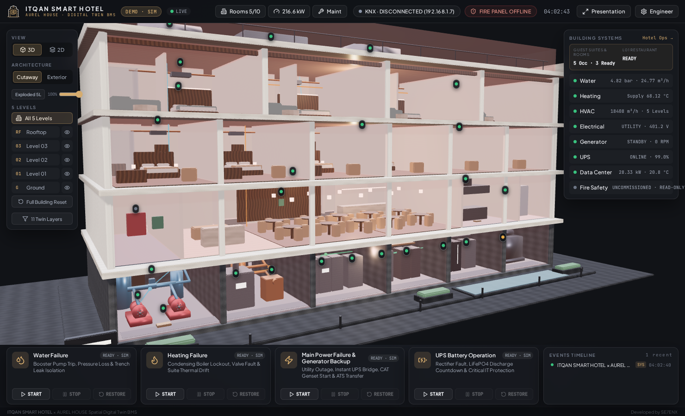
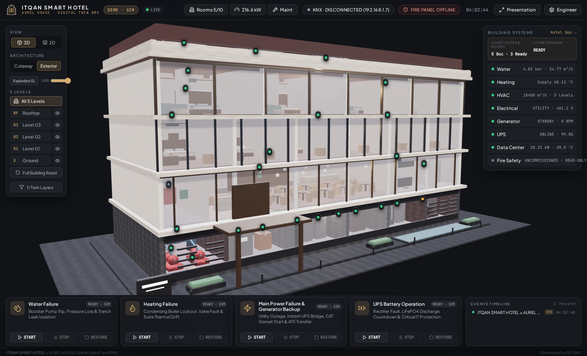
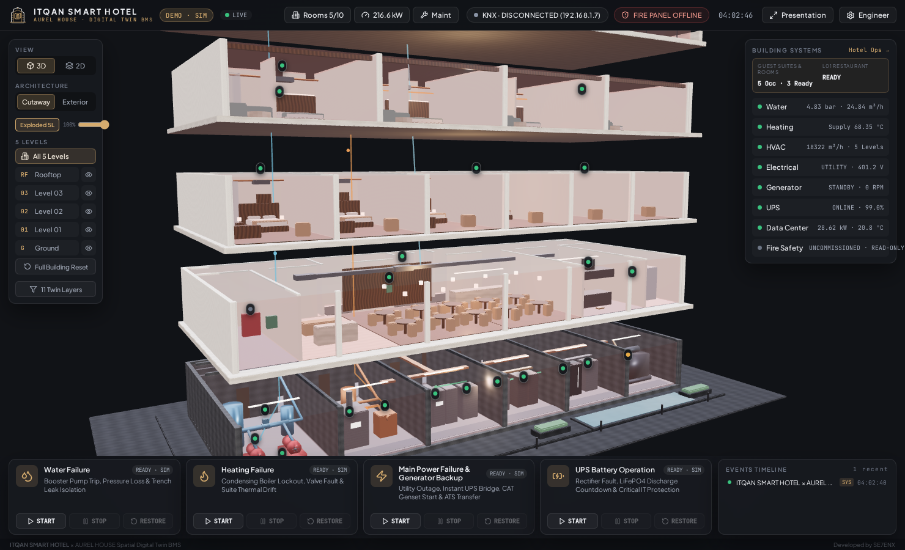
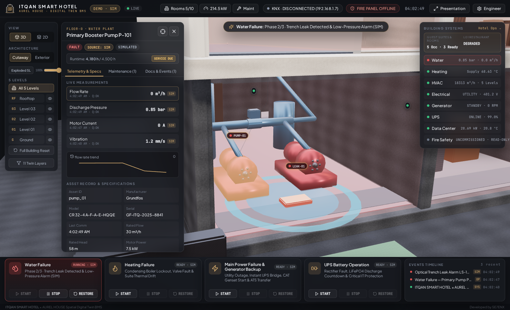
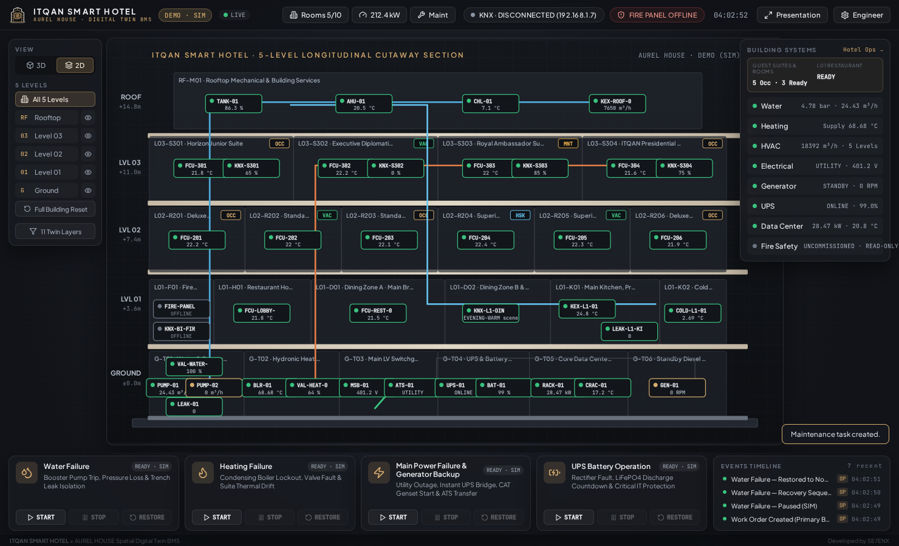
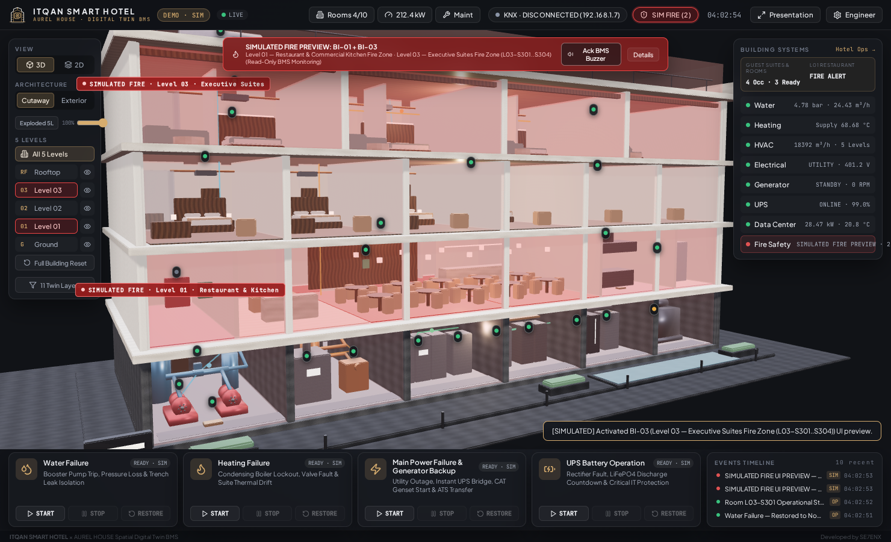
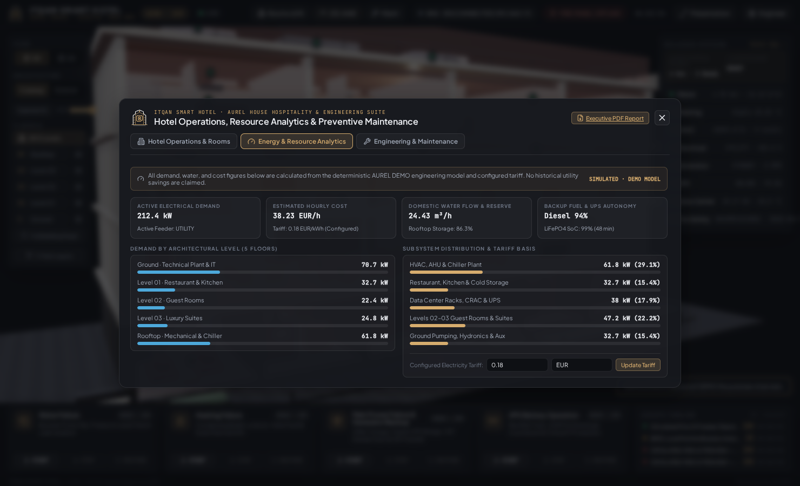
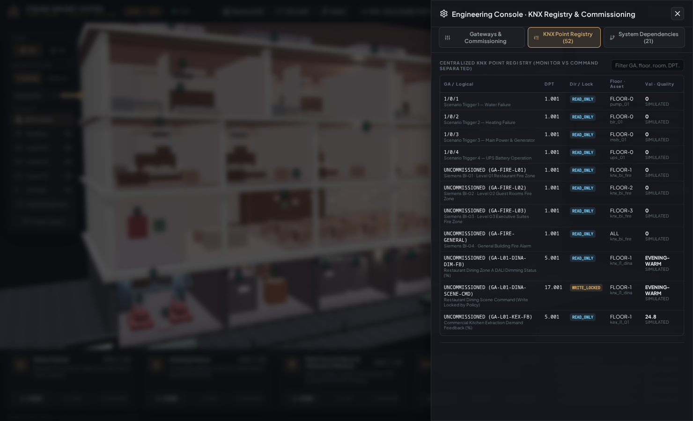

# AUREL HOUSE
### Spatial Digital Twin & Building Management System

**AUREL HOUSE**

A local-first, five-level Spatial Digital Twin and Building Management System designed to demonstrate the integration of hospitality operations, building automation, engineering monitoring, and interactive 3D visualization within a unified platform.

**Platform:** AUREL HOUSE  
**Engineering & Development:** Abdelkhalek Mammeri — SE7ENX

---

## Project Overview

AUREL HOUSE brings together spatial visualization and building management into a unified engineering interface.

The platform represents a five-level hospitality property, connecting architectural spaces with building systems, operational information, equipment monitoring, and engineering workflows.

Its design focuses on local-first operation, transparent system states, modular integration, and clear separation between simulated demonstrations and verified physical hardware feedback.

## Dashboard Showcase

### 01 — Main 3D Cutaway

Interactive architectural cutaway presenting the building structure and its integrated spaces.

### 02 — Exterior Visualization

Three-dimensional exterior representation of the hospitality property.

### 03 — Exploded Five-Level View

Separated architectural levels for spatial inspection and system visualization.

### 04 — Water Failure Scenario

Engineering scenario demonstrating asset-level fault visualization and operational response.

### 05 — 2D Five-Level Digital Twin

Multi-level 2D cutaway for navigating and inspecting the building layout.

### 06 — Siemens Fire Monitoring

Multi-zone fire monitoring interface designed around passive, read-only monitoring architecture.

### 07 — Operations & Energy Analytics

Operational dashboards covering energy, water consumption, maintenance, and building performance.

### 08 — Engineering & KNX Registry

Engineering interface presenting the KNX group address registry and system integration points.

---

## Engineering Architecture

The platform is organized around five architectural levels:

| Level | Functional Area |
|---|---|
| Ground Level | Technical plant and infrastructure |
| Level 01 | Restaurant and commercial kitchen |
| Level 02 | Guest rooms — R201 to R206 |
| Level 03 | Executive suites — S301 to S304 |
| Rooftop | Mechanical and building services |

## Core Capabilities

- Interactive 3D digital twin with synchronized 2D and 3D views.
- Exterior, cutaway, and exploded building visualization.
- Individual floor isolation and structural layer inspection.
- KNX engineering registry with 52 defined integration points.
- Separation of monitoring feedback and controlled commands.
- Default KNX write protection.
- Passive, read-only four-channel fire monitoring architecture.
- Water, heating, main power, generator backup, and UPS failure/recovery scenarios.
- Hospitality room status monitoring.
- Energy and water analytics.
- Maintenance management covering 39 registered assets.
- Work-order workflows and executive PDF reporting.

## Technology Stack

- **Frontend:** React, TypeScript
- **3D Visualization:** Three.js, React Three Fiber
- **Backend:** Python, FastAPI
- **Database:** SQLite with WAL
- **Building Automation:** KNXnet/IP, xknx
- **Communication:** REST API, WebSocket

## Engineering Principles

**Local-first architecture**  
Designed around local infrastructure and reduced dependency on external cloud services.

**Hardware honesty**  
Simulated values are identified as simulated. Live hardware feedback is represented as live only when the physical integration has been verified.

**Controlled access**  
Monitoring and command execution are treated as separate engineering functions, with protected write access.

**Modular integration**  
The architecture is designed to accommodate building automation, monitoring, operational services, and future integrations.

## Project Scope

AUREL HOUSE is presented here as a technical project showcase. The screenshots document its interface, architectural visualization, and engineering capabilities.

The presence of an integration interface or monitoring architecture does not, by itself, certify physical commissioning or operational connection to every referenced device.

---

## Engineering & Development

**Developed by Abdelkhalek Mammeri**  
**Known as SE7ENX**

*Spatial systems. Building intelligence. Engineering integration.*

